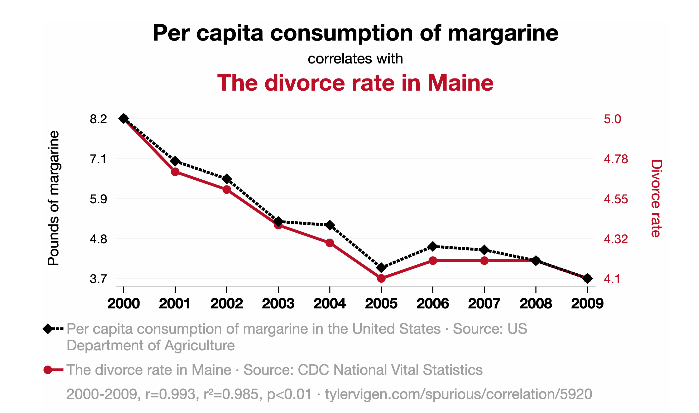
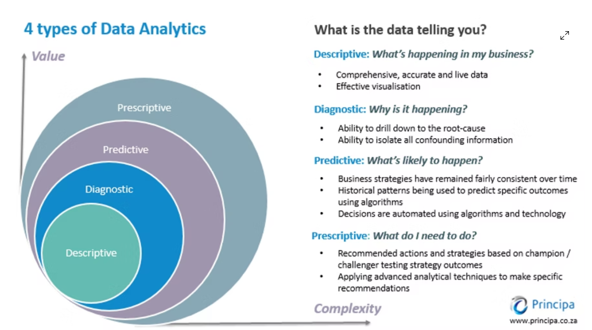
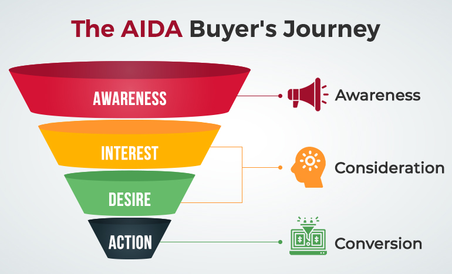
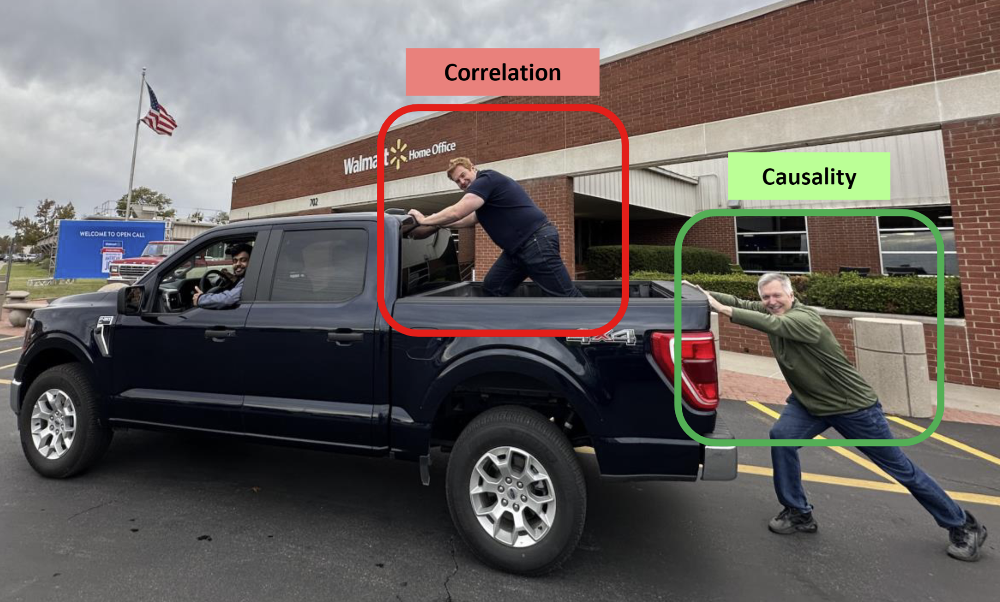

```{r setup}
#| include: false
library(data.table)
library(ggplot2)
library(scales)
library(knitr)

usc_red  <- "#990000"
usc_gold <- "#E69F00"
blue     <- "#0072B2"
set.seed(566)

fmt_n <- function(x) format(x, big.mark = ",", scientific = FALSE)
pct   <- function(x, d = 1) paste0(format(round(100 * x, d), nsmall = d), "%")
pp    <- function(x, d = 1) paste0(format(round(100 * x, d), nsmall = d), " pp")
usd   <- function(x) paste0("$", format(round(x), big.mark = ","))

# --- 1. randomization demo: 2,000 customers, coupon assigned two ways ---
n_cust <- 2000
cust <- data.table(
  past_spend = round(exp(rnorm(n_cust, log(80), 0.6))),
  age        = round(rnorm(n_cust, 38, 10)))
cust[, coupon_random   := rbinom(n_cust, 1, 0.5)]
cust[, coupon_targeted := rbinom(n_cust, 1, plogis(-1 + 1.3 * scale(log(past_spend))[, 1]))]
bal <- rbind(
  cust[, .(how = "Coin flip (random)", group = ifelse(coupon_random == 1, "Coupon", "No coupon"),
           past_spend, age)],
  cust[, .(how = "Targeted at big spenders", group = ifelse(coupon_targeted == 1, "Coupon", "No coupon"),
           past_spend, age)])
bal_tab <- bal[, .(customers = .N,
                   `avg. past spend` = usd(mean(past_spend)),
                   `avg. age` = round(mean(age), 1)), by = .(how, group)]
setnames(bal_tab, c("how", "group"), c("How the coupon was assigned", "Group"))
rnd_gap <- cust[, mean(past_spend[coupon_random == 1]) - mean(past_spend[coupon_random == 0])]
tgt_gap <- cust[, mean(past_spend[coupon_targeted == 1]) - mean(past_spend[coupon_targeted == 0])]
rnd_spend <- cust[, usd(c(mean(past_spend[coupon_random == 0]), mean(past_spend[coupon_random == 1])))]

# --- 2. A/B test: two subject lines ---
nA <- 10000; nB <- 10000
openA <- 2130; openB <- 2310
pA <- openA / nA; pB <- openB / nB
diff_ab <- pB - pA
se_ab   <- sqrt(pA * (1 - pA) / nA + pB * (1 - pB) / nB)
z_ab    <- diff_ab / se_ab
p_ab    <- 2 * (1 - pnorm(abs(z_ab)))
ci_ab   <- diff_ab + c(-1, 1) * 1.96 * se_ab
# same rates, ten times fewer emails
n_small <- 1000
se_small <- sqrt(pA * (1 - pA) / n_small + pB * (1 - pB) / n_small)
z_small  <- diff_ab / se_small
p_small  <- 2 * (1 - pnorm(abs(z_small)))

# --- 3. what chance alone produces: 2,000 fake A/A tests, no true difference ---
n_fake <- 2000
fake <- data.table(open_b = rbinom(n_fake, nB, pA), open_a = rbinom(n_fake, nA, pA))
fake[, diff_pp := 100 * (open_b / nB - open_a / nA)]
fake_first <- fake[1:3, .(`Fake test` = 1:3, `A opened` = fmt_n(open_a), `B opened` = fmt_n(open_b),
                          `Gap, B minus A (pct. points)` = sprintf("%+.2f", diff_pp))]
fake_as_big <- fake[abs(diff_pp) >= 100 * diff_ab, .N]
fake_range  <- quantile(fake$diff_pp, c(0.025, 0.975))

# --- 4. ad measurement: attributed vs incremental ---
spend      <- 50000
rev_per    <- 100
attr_conv  <- 1800
roas_attr  <- (attr_conv * rev_per - spend) / spend
n_treat    <- 90000; n_hold <- 10000
cr_treat   <- 0.032; cr_hold <- 0.028
lift       <- cr_treat - cr_hold
incr_conv  <- lift * n_treat
iroas      <- (incr_conv * rev_per - spend) / spend

# --- 5. the holdout catch: only some people ever see an ad ---
share_exposed <- 0.20
base_exposed  <- 0.040; base_unexposed <- 0.025
effect        <- 0.020
treat_exposed <- base_exposed + effect
ctrl_all      <- share_exposed * base_exposed + (1 - share_exposed) * base_unexposed
treat_all     <- share_exposed * treat_exposed + (1 - share_exposed) * base_unexposed
n_exposed     <- share_exposed * n_treat
# the catch example must reproduce the holdout slide: 3.2% vs 2.8%, 360 incremental conversions
stopifnot(isTRUE(all.equal(ctrl_all, cr_hold)), isTRUE(all.equal(treat_all, cr_treat)),
          isTRUE(all.equal(effect * n_exposed, incr_conv)))
kinds_tab <- data.table(
  `Kind of person` = c("Heavy internet users (the ad reaches them)",
                       "Light users (the ad never reaches them)"),
  `Share of the audience` = c(pct(share_exposed, 0), pct(1 - share_exposed, 0)),
  `Converts without ads` = c(pct(base_exposed), pct(base_unexposed)),
  `Converts if shown the ad` = c(pct(treat_exposed), paste0(pct(base_unexposed), " (never shown)")))
# Attempt 3 head counts, and how clearly each attempt stands out from noise
# (z = gap / standard error, same formula as the A/B test)
n_hold_exposed <- share_exposed * n_hold
se_a1 <- sqrt(cr_treat * (1 - cr_treat) / n_treat + cr_hold * (1 - cr_hold) / n_hold)
se_a3 <- sqrt(treat_exposed * (1 - treat_exposed) / n_exposed +
              base_exposed * (1 - base_exposed) / n_hold_exposed)
z_a1 <- lift / se_a1
z_a3 <- effect / se_a3

# --- 6. attribution rules on one customer journey ---
journey <- data.table(
  Rule = c("Last-touch", "First-touch", "Linear", "Time-decay"),
  `Search ad (day 1)` = c("$0", "$100", "$33", "$20"),
  `Social ad (day 3)` = c("$0", "$0", "$33", "$30"),
  `Email (day 5)`     = c("$100", "$0", "$33", "$50"))

# --- 7. adstock ---
adstock <- data.table(Week = 1:5, `Spend` = c("$100", "$0", "$0", "$0", "$0"),
                      `Adstock (50% carries over)` = c("100", "50", "25", "12.5", "6.25"))

# --- 8. stats refresher: coin flips (kept last so the draws above do not change) ---
n_flip <- 100
flip_runs <- rbinom(5, n_flip, 0.5)
flip_tab <- data.table(Run = 1:5, `Heads out of 100` = flip_runs,
                       `Share of heads` = pct(flip_runs / n_flip, 0))
n_runs <- 2000
flips <- data.table(heads = rbinom(n_runs, n_flip, 0.5))
se_flip <- sd(flips$heads)
se_r    <- round(se_flip)
flip_in <- flips[heads >= 50 - 1.96 * se_flip & heads <= 50 + 1.96 * se_flip, .N] / n_runs
se_f100 <- 100 * sqrt(0.5 * 0.5 / 100)
se_f10k <- 100 * sqrt(0.5 * 0.5 / 10000)
run1    <- flip_runs[1]
```

# Before We Start {.divider}

## Housekeeping

- **Homework 4** is out, due **Nov. 24** on Brightspace
- Today: **randomized experiments** and how firms measure advertising
- Thursday: causality when you **cannot** run an experiment (observational data)
- Next Tuesday, Nov. 17: in-class **causality exercise**, bring your laptop
- Thursday, Nov. 19: class time to **work on your group project** with your team
- Final presentations: **Dec. 1 and Dec. 3**

## Where we are in the course {.smaller-90}

- Weeks 3 to 11 were about **prediction**: regression, logit, trees, forests, text. All of them answer "what is likely to happen?"
- The next two weeks are about a different question: **"did my action cause the change?"**
  - Did the coupon raise sales?
  - Did the ad campaign bring in customers who would not have come anyway?
  - Did the new badge on the product page sell more units?
- A model that predicts well does **not** answer these. Today we see why, and what does

# Stats Refresher {.divider}

## Averages from samples bounce around {.smaller-90}

Today we compare groups: coupon vs. no coupon, subject line A vs. B. Groups always differ a little, even when nothing is going on. Start with a coin.

Flip a fair coin `r n_flip` times. The truth is 50% heads. Five runs on the computer:

```{r flip-table}
kable(flip_tab, align = "ccc")
```

- No run gives exactly 50. The share moves around by **luck of the draw**, although the coin never changed
- Same with customers: the average spend of 1,000 random customers is not the average of all customers, and another 1,000 would give a different number
- This bounce is called **sampling noise**. The next slides measure it

## How much does it bounce? {.smaller-90}

```{r flip-hist}
#| fig-width: 8
#| fig-height: 4
p_flips <- ggplot(flips, aes(x = heads)) +
  geom_histogram(binwidth = 1, fill = blue, color = "white") +
  geom_vline(xintercept = 50, color = usc_red, linewidth = 1) +
  labs(title = paste0(fmt_n(n_runs), " runs of ", n_flip, " coin flips"),
       x = "Heads out of 100", y = "Number of runs") +
  theme_minimal(base_size = 14)
p_flips
```

::: {.smaller-80 .muted}
We repeated the `r n_flip` flips `r fmt_n(n_runs)` times and counted heads each time. The red line is the truth, 50. What do you see?
:::

## How much does it bounce? The standard error {.smaller-80}

```{r flip-hist-2}
#| fig-width: 8
#| fig-height: 3
p_flips
```

- The runs pile up around 50 and spread out by about **±`r se_r` heads** either way. That typical distance from the truth is the **standard error**: here `r round(se_flip, 1)` heads, or `r round(se_flip, 1)` percentage points
- Nobody runs `r fmt_n(n_runs)` experiments to get it. A formula gives the same number: √(p × (1 − p) / n) = √(0.5 × 0.5 / 100) = √0.0025 = 0.05 = `r se_f100` points
- Same formula with `r fmt_n(10000)` flips: `r se_f10k` points. **More data, less noise**: 100 times the data cuts the noise by 10 (the square root)

## The 95% rule, and the confidence interval {.smaller-90}

- In the histogram, about 95% of the runs (`r pct(flip_in, 0)` in this simulation) land within **2 standard errors** of the truth: 50 ± 2 × `r se_r` = `r 50 - 2 * se_r` to `r 50 + 2 * se_r` heads (the exact multiplier is 1.96, which is why 1.96 shows up everywhere)
- Now flip it around. In real life you have **one** run and do not know the truth. But "my result ± 2 standard errors" is a range that contains the truth 95 times out of 100. That range is the **95% confidence interval**
- Example: run 1 gave `r run1` heads. `r run1` ± 2 × `r se_r` = `r run1 - 2 * se_r` to `r run1 + 2 * se_r`. The range contains 50, so nothing says the coin is unfair

## Is a difference real? The p-value {.smaller-90}

- Two groups, two averages, a gap. Start from the boring explanation: **there is no real difference**, the gap is sampling noise
- The **p-value** is how often sampling noise alone would produce a gap at least this big
- Small p-value, below **0.05** by convention (fooled by luck 1 time in 20): noise is a bad explanation, the gap is **statistically significant**
- Shortcut: gap ÷ standard error = how many standard errors away. Beyond about 2, p is below 0.05
- You saw all of this in week 4: coefficient, standard error in parentheses, stars for p < 0.05 (`*`), 0.01 (`**`), 0.001 (`***`). Thursday's tables use the same format

::: {.box}
Everything that follows today is this logic applied to one comparison: treatment group vs. control group.
:::

# Correlation Is Not Causation {.divider}

## The question every marketer asks {.smaller-90}

"We ran the campaign and sales went up. Did the campaign do it?"

- The data can show you a **correlation**: when spend was high, sales were high
- A correlation tells you one thing: **the two variables move together**. Anything beyond that requires assumptions
- Sales may have gone up because of the campaign, or because of the season, or because the campaign was launched **when sales were already rising**
- All three stories produce the same correlation. The correlation cannot tell them apart

## Two lines that move together

{fig-align="center" width="78%"}

::: {.smaller-80 .muted}
What do you see? Does eating less margarine save marriages in Maine?
:::

## Two lines that move together, explained {.smaller-90}

- The correlation is 0.99, as strong as it gets. And there is **no causal link** at all
- With thousands of series to choose from, some pairs move together **by chance**. Pick enough pairs and you will always find one
- Three ways two variables can move together without one causing the other:
  - **Chance**, as here
  - **A third factor** drives both (a hidden "cause of both")
  - **Reverse causality**: B causes A, not A causes B

## Three classic traps {.smaller-80}

| What the data show | What is really going on |
|-------------------|------------------------|
| People carrying **umbrellas** on days it rains | Umbrellas do not cause rain. People check the forecast and act **ahead of** the rain: forward-looking behavior |
| Kids who get **tutoring** have lower grades | Tutoring does not lower grades. The kids who get tutoring are the ones who were **already struggling**: selection |
| **Ice cream sales** and **drownings** rise together | Neither causes the other. **Summer** drives both: a hidden third factor |

::: {.box}
In every marketing version of these traps, the "treatment" (the ad, the coupon, the feature) was **not handed out at random**. Somebody chose who gets it, and that choice is correlated with the outcome.
:::

## Why causality matters {.smaller-80}

{fig-align="center" width="64%"}

- **Descriptive** ("what is happening?") and **predictive** ("what is likely to happen?") run on correlations. If umbrellas predict rain, a forecaster can use umbrellas
- **Diagnostic** ("why?") and **prescriptive** ("what should we do?") need causality. Handing out umbrellas will not make it rain

# The Counterfactual {.divider}

## The one thing you can never see {.smaller-90}

Maria got the coupon and spent **$60**. Did the coupon work?

- To answer, you need to know what Maria would have spent **without** the coupon. That world never happened. It is called the **counterfactual**
- The effect of the coupon on Maria is $60 minus the counterfactual. One of the two numbers is **missing, for every single customer, always**
- This is a **missing-data problem** that no amount of extra data on Maria can fix: you only ever get one of her two worlds

::: {.box}
Causal inference is the art of filling in the missing world **credibly**.
:::

## Every customer is missing half the table {.smaller-80}

| Customer | Got the coupon? | Spend with coupon | Spend without coupon | Effect |
|---|:---:|:---:|:---:|:---:|
| Maria | yes | $60 | **?** | ? |
| James | yes | $45 | **?** | ? |
| Priya | no | **?** | $38 | ? |
| Tom | no | **?** | $52 | ? |

- The effect for one person needs both columns. Nobody has both
- The way out is to stop asking about individuals and ask about **groups**: compare the **average** spend of the coupon group with the average of the no-coupon group
- That only works if the two groups are **the same kind of people**, so that the no-coupon group's average is a fair stand-in for the coupon group's missing column

## Two ways to hand out the coupon {.smaller-80}

`r fmt_n(n_cust)` customers (simulated). We assign the coupon two ways and compare the groups **before** the coupon does anything:

```{r balance-table}
kable(bal_tab, align = "llccc")
```

::: {.smaller-90 .muted}
What do you see? In which case would "coupon group average minus no-coupon group average" be a fair measure of the coupon?
:::

## Two ways to hand out the coupon, explained {.smaller-80}

```{r balance-table-2}
kable(bal_tab, align = "llccc")
```

- **Coin flip**: the two groups match on past spend (a gap of `r usd(abs(rnd_gap))`) and on age. They also match on everything we did **not** measure, because a coin does not look at the customer
- **Targeted**: the coupon group was already spending `r usd(tgt_gap)` more **before** any coupon. Any sales difference afterwards mixes two things: the coupon, and the fact that these were bigger spenders to begin with

::: {.box}
**Randomization** is what makes the no-coupon group a credible stand-in for the missing world.
:::

## The logic of an experiment {.smaller-90}

- Split the units (customers, users, stores) **at random** into a treatment group and a control group
- Treat one group, not the other. Everything else is held constant **on average**, because chance decided who went where
- Compare the average outcome in the two groups. The difference is the **causal effect** of the treatment, plus some noise from the coin flips

::: {.box}
This is the whole idea. Everything else today is about doing it well, and about what happens when firms skip it.
:::

## Anatomy of a randomized experiment {.smaller-90}

| Element | What it is | Running example |
|---|---------|----------|
| **Population** | the units you randomize | 20,000 email subscribers |
| **Treatment** | the one thing you change | a new subject line |
| **Randomization** | how units are assigned | 50/50 coin flip per subscriber |
| **Outcome** | what you measure | opened the email (yes/no) |

- In practice, a **randomized controlled trial** (RCT) in marketing is just this table with the cells filled in
- The hardest cell is often the second one: the treatment should change **one thing**, or you will not know which change did the work

## Randomization in practice {.smaller-90}

- The **unit** of randomization matters: user, session, store, city, campaign. Pick the unit at which the treatment is delivered and at which outcomes are measured
- Always **check balance**: compare pre-treatment variables (past spend, age, device, region) across groups, exactly like the coin-flip vs. targeted table in the coupon example (no coupon `r rnd_spend[1]` vs. coupon `r rnd_spend[2]` in past spend, same age). Randomization produces balanced groups on average; a specific draw can still come out unbalanced
- If the groups are **not** balanced, suspect the randomization before you trust the result (the "random" split in many companies is a rule like "odd user IDs", which is not always random)

# A/B Testing {.divider}

## A/B test: the simplest experiment {.smaller-90}

- Two versions, **A** and **B**, that differ in **one element**. Users are randomly shown one or the other. Measure the outcome, pick the winner
- It is an RCT with a product name. Used for web design, pricing, ad creatives, subject lines, recommendation algorithms
- Large platforms run thousands at a time; a newsletter can run one with a built-in button

::: {.box}
The next five slides are one A/B test, start to finish, with every number worked out.
:::

## One A/B test, worked out {.smaller-90}

Two subject lines. `r fmt_n(nA)` subscribers get A, `r fmt_n(nB)` get B.

| | Subject line A | Subject line B |
|---|:---:|:---:|
| Emails sent | `r fmt_n(nA)` | `r fmt_n(nB)` |
| Opened | `r fmt_n(openA)` | `r fmt_n(openB)` |
| Open rate | `r pct(pA)` | `r pct(pB)` |

- B opened `r pp(diff_ab)` more often (`r pct(pB)` minus `r pct(pA)`)
- Before declaring B the winner: **could a gap this size happen by chance**, with the two subject lines equally good?

## Is B really better, or just lucky? {.smaller-80}

- Flip two fair coins `r fmt_n(nA)` times each. They will **not** land heads the same number of times. The difference is luck
- Same for emails: even if A and B were **exactly the same**, their open counts would differ a little, by luck
- So the question is: **how big a gap can luck alone make?** We find out by running fake tests on the computer

**One fake test:**

1. Every email gets the **same** `r pct(pA)` chance of being opened, whatever the subject line (that is A's open rate)
2. The computer "sends" `r fmt_n(nA)` emails as A and `r fmt_n(nB)` as B, and rolls the dice for each one: opened or not
3. Count the opens in A and in B. The gap between them is **pure luck**, because the two groups were identical

We do this `r fmt_n(n_fake)` times. The first three fake tests:

```{r fake-first}
kable(fake_first, align = "cccc")
```

::: {.box}
Next: how often does luck alone make a gap as big as our `r round(100 * diff_ab, 1)` percentage points (`r pct(pB)` minus `r pct(pA)`)?
:::

## What chance alone produces {.smaller-90}

```{r fake-hist}
#| fig-width: 8
#| fig-height: 4
p_fake <- ggplot(fake, aes(x = diff_pp)) +
  geom_histogram(binwidth = 0.2, fill = blue, color = "white") +
  geom_vline(xintercept = 100 * diff_ab, color = usc_red, linewidth = 1.2) +
  annotate("text", x = 100 * diff_ab, y = Inf, vjust = 1.5, hjust = 1.1,
           label = paste0("our gap: ", pp(diff_ab)), color = usc_red, size = 5) +
  labs(title = paste0(fmt_n(n_fake), " fake tests where A and B are equally good"),
       x = "Open rate B minus open rate A, in percentage points", y = "Number of fake tests") +
  theme_minimal(base_size = 14)
p_fake
```

::: {.smaller-80 .muted}
Each bar counts how many of the `r fmt_n(n_fake)` fake tests produced that gap. The red line is the gap we actually observed. What do you see?
:::

## What chance alone produces, explained {.smaller-80}

```{r fake-hist-2}
#| fig-width: 8
#| fig-height: 3.2
p_fake
```

- Luck alone does make gaps, but small ones: 95 out of 100 fake tests have a gap between `r round(fake_range[1], 1)` and `r round(fake_range[2], 1)` percentage points
- A gap as big as ours (`r round(100 * diff_ab, 1)` percentage points) showed up in only **`r fake_as_big` of `r fmt_n(n_fake)`** fake tests. That fraction (`r fake_as_big`/`r fmt_n(n_fake)` = `r pct(fake_as_big / n_fake, 2)`) is what a **p-value** is: how often luck alone produces what we saw
- Our gap is far outside what luck produces. B is better

## The same thing, with a formula {.smaller-80}

The simulation is what a **hypothesis test** does with a formula instead of `r fmt_n(n_fake)` fake tests:

| Step | Question | Arithmetic | Result |
|---------|-----------|-----------|-----|
| 1. Null hypothesis | what if A and B are equally good? | gap = 0 | |
| 2. Difference | how big is the observed gap? | `r pct(pB)` − `r pct(pA)` | `r pp(diff_ab)` |
| 3. Standard error | how much does chance move the gap? | √(p<sub>A</sub>(1 − p<sub>A</sub>) / n<sub>A</sub> + p<sub>B</sub>(1 − p<sub>B</sub>) / n<sub>B</sub>) | `r pp(se_ab, 2)` |
| 4. z | how many standard errors is the gap? | `r round(100 * diff_ab, 1)` / `r round(100 * se_ab, 2)` | `r round(z_ab, 2)` |
| 5. p-value | how often would chance produce this? | from z | `r format(round(p_ab, 3), nsmall = 3)` |
| 6. 95% confidence interval | which gaps are plausible? | `r round(100 * diff_ab, 1)` ± 1.96 × `r round(100 * se_ab, 2)` | `r sprintf("%.1f", 100 * ci_ab[1])` to `r sprintf("%.1f", 100 * ci_ab[2])` pp |

- The **95% confidence interval** is gap ± 1.96 standard errors. Read it as: the true gap is plausibly anywhere from `r sprintf("%.1f", 100 * ci_ab[1])` to `r sprintf("%.1f", 100 * ci_ab[2])` percentage points. It says how big the effect is, which the p-value does not
- Where 1.96 comes from: ± 1.96 standard errors covers 95% of what luck alone produces (1.96 × `r round(100 * se_ab, 2)` = `r round(1.96 * 100 * se_ab, 1)`, the `r round(fake_range[1], 1)` to `r round(fake_range[2], 1)` range of the fake tests)
- **Small samples are noisy.** Same open rates with `r fmt_n(n_small)` emails per arm: standard error `r pp(se_small, 2)`, z = `r round(z_small, 2)`, p = `r round(p_small, 2)`. The same gap, and no conclusion

## Common mistakes in A/B testing {.smaller-80}

- **Peeking**: checking the test every day and stopping the moment B looks ahead. Remember the fake tests: even when A and B are identical, B is ahead on many days just by luck. Stop on one of those days and you crown a winner that is not one. Decide the number of emails in advance and read the result once, at the end
- **Too short, too small**: with `r fmt_n(n_small)` emails per arm, our same `r round(100 * diff_ab, 1)`-point gap gave p = `r round(p_small, 2)` (previous slide). The test could not tell luck from a real effect. "Not significant" then means "we could not tell", not "no effect"
- **Many tests at once**: the rule "call it a winner when p < 0.05" means we accept being fooled by luck 1 time in 20. So if you test 20 changes that do nothing, about 1 of them will look like a winner by luck alone. Expect it, and re-test before you ship it
- **Spillovers**: the control group must not be touched by the treatment. If treated users talk to control users (a referral bonus), or compete with them for the same drivers or inventory (a discount on rides), the control group changes too, and the comparison is off
- **Significance is not value**: p-values get small when the sample is huge. With 10 million users, a gain of 0.01 points is "significant". Significant means "not luck", not "worth it". Whether to ship it is a business question: what is 0.01 points worth in dollars?

# Ad Measurement {.divider}

## What ad measurement is, and why it is hard {.smaller-90}

- **Ad measurement**: figuring out what advertising did to the outcomes you care about (awareness, clicks, conversions, sales)
- It is hard because the effect of an ad depends on its content, where it ran, when, to whom, on market conditions, and on **all the ads that came before**
- It is **expensive**. So a measurement should exist to inform a decision: which channel gets the budget, whether to keep the campaign. A number that will not change a decision is money wasted

## The number everyone reports: ROAS {.smaller-80}

A campaign spends **`r usd(spend)`**. The platform's dashboard **attributes** `r fmt_n(attr_conv)` conversions to it, each worth `r usd(rev_per)`.

- Attributed revenue: `r fmt_n(attr_conv)` × `r usd(rev_per)` = **`r usd(attr_conv * rev_per)`**
- **ROAS** (return on ad spend) = (attributed revenue − spend) / spend = (`r usd(attr_conv * rev_per)` − `r usd(spend)`) / `r usd(spend)` = **`r round(roas_attr, 1)`**

A return of `r round(roas_attr, 1)` dollars per dollar. Great campaign?

::: {.box}
The question the dashboard does not answer: **how many of those `r fmt_n(attr_conv)` people would have bought anyway**, with no ad? "Attributed" means the person saw or clicked the ad before buying. That is a correlation.
:::

## Attribution vs. incrementality {.smaller-80}

| | Attribution | Incrementality |
|---|-----------|-------------|
| The question | which ad or channel gets **credit** for a conversion? | how much of the behavior **would not have happened** without the ad? |
| The data | observational: click paths, impressions | experimental: holdout tests, ghost ads, geo tests |
| Typical output | "search 40%, display 30%, social 30%" | lift in %, incremental conversions, **iROAS** |
| Limitation | correlational: cannot tell whether the ad **caused** anything | needs randomization, which is harder to set up |

::: {.box}
Same word, two meanings: **ROAS** uses attributed revenue; **incremental ROAS (iROAS)** uses only the revenue the ads caused. They can be very different numbers.
:::

## Attribution rules, on one customer {.smaller-80}

One customer sees a search ad on day 1, a social ad on day 3, gets an email on day 5, and buys for $100. Who gets the credit?

```{r journey}
kable(journey, align = "lccc")
```

- Every rule gives a **different answer** for the same purchase, and all of them add up to $100
- Not one of them asks whether the customer **would have bought anyway**. If she would have, the right answer is $0 for everyone
- Easy to compute, so widely used; but they allocate credit, they do not measure cause

## Ads work along a funnel {.smaller-90}

{fig-align="center" width="52%"}

- Short-run responses (clicks, purchases this week) are **much easier** to measure than long-run ones (awareness, brand preference)
- Most incrementality tests measure the bottom of the funnel. Keep in mind what they leave out

## Measuring incrementality: the holdout test {.smaller-80}

Same campaign as the ROAS slide: **`r usd(spend)`** spent, **`r fmt_n(attr_conv)`** attributed conversions, `r usd(rev_per)` each. The audience is `r fmt_n(n_treat + n_hold)` people. This time we randomly **withhold** the ads from `r fmt_n(n_hold)` of them. That slice is the control group.

| | Treatment (ads turned on) | Holdout, the control group (ads turned off) |
|---|:---:|:---:|
| Users | `r fmt_n(n_treat)` | `r fmt_n(n_hold)` |
| Conversion rate | `r pct(cr_treat)` | `r pct(cr_hold)` |

- Lift = `r pct(cr_treat)` − `r pct(cr_hold)` = **`r pp(lift)`**
- Incremental conversions = `r pp(lift)` × `r fmt_n(n_treat)` users = **`r fmt_n(incr_conv)`**, not `r fmt_n(attr_conv)`
- Incremental revenue = `r fmt_n(incr_conv)` × `r usd(rev_per)` = `r usd(incr_conv * rev_per)`
- **iROAS** = (`r usd(incr_conv * rev_per)` − `r usd(spend)`) / `r usd(spend)` = **`r round(iroas, 2)`**

::: {.box}
Same campaign. The dashboard said `r round(roas_attr, 1)`; the experiment says the campaign **lost money**. The `r fmt_n(attr_conv - incr_conv)` other buyers were going to buy anyway.
:::

## The catch with holdouts {.smaller-90}

Same campaign as the holdout slide. "Ads turned on" does not mean "sees the ads": most people in the treatment group **never see an ad**, because an ad only appears if the person visits a site where your bid wins the auction. Say that happens to `r pct(share_exposed, 0)` of them (`r fmt_n(n_exposed)` of the `r fmt_n(n_treat)`), and they are not a random `r pct(share_exposed, 0)`: they are the heavy internet users.

```{r kinds}
kable(kinds_tab, align = "lccc")
```

::: {.smaller-90 .muted}
What is the true causal effect of seeing the ad? Which two numbers in the table give it?
:::

## The catch with holdouts, explained {.smaller-90}

Same campaign as the holdout slide. "Ads turned on" does not mean "sees the ads": most people in the treatment group **never see an ad**, because an ad only appears if the person visits a site where your bid wins the auction. Say that happens to `r pct(share_exposed, 0)` of them (`r fmt_n(n_exposed)` of the `r fmt_n(n_treat)`), and they are not a random `r pct(share_exposed, 0)`: they are the heavy internet users.

```{r kinds-explained}
kable(kinds_tab, align = "lccc")
```

::: {.box}
The true effect of seeing the ad is **`r pp(effect)`** (`r pct(treat_exposed)` − `r pct(base_exposed)`): the same people, with and without the ad. We know it because we made up the numbers. Can we recover it from the data? Three attempts.
:::

## Attempt 1: whole treatment group vs. whole control group {.smaller-90}

The obvious choice, and what we did on the holdout slide: compare everyone in the treatment group (ads turned on, whether they saw one or not) with everyone in the holdout (ads turned off). Same two kinds of people as before:

```{r kinds-2}
kable(kinds_tab, align = "lccc")
```

- Treatment group: heavy users saw the ad, light users did not. Average rate = `r pct(share_exposed, 0)` × `r pct(treat_exposed)` + `r pct(1 - share_exposed, 0)` × `r pct(base_unexposed)` = `r pct(treat_all)`
- Holdout: nobody saw an ad. Average rate = `r pct(share_exposed, 0)` × `r pct(base_exposed)` + `r pct(1 - share_exposed, 0)` × `r pct(base_unexposed)` = `r pct(ctrl_all)`
- Gap: `r pct(treat_all)` − `r pct(ctrl_all)` = **`r pp(treat_all - ctrl_all)`**, the number on the holdout slide. Fair, because the groups were randomized, and right in total: `r pp(lift)` × `r fmt_n(n_treat)` = `r fmt_n(incr_conv)` incremental conversions
- But the ad only did something to the `r fmt_n(n_exposed)` people who saw it. Its `r pp(effect)` effect is **diluted** across all `r fmt_n(n_treat)`: `r sprintf("%.1f", 100 * effect)` × `r pct(share_exposed, 0)` = `r sprintf("%.1f", 100 * effect * share_exposed)`. A tiny gap, hard to tell from sampling noise unless the sample is enormous. So analysts look for something sharper

## Attempt 2: exposed vs. not exposed {.smaller-90}

The tempting fix for the dilution: inside the treatment group (ads turned on), compare only the people who actually saw an ad with the people who never did:

```{r kinds-3}
kable(kinds_tab, align = "lccc")
```

- Saw the ad: `r pct(treat_exposed)` convert. Did not see it: `r pct(base_unexposed)`. Gap: **`r pp(treat_exposed - base_unexposed)`**
- Wrong, and it is the most common number in ad reports. The two groups are **different kinds of people**: heavy users convert at `r pct(base_exposed)` with no ad at all, light users at `r pct(base_unexposed)`. The gap is mostly who they are, not the ad
- `r pp(treat_exposed - base_unexposed)` is `r round((treat_exposed - base_unexposed) / effect, 1)` times the true `r pp(effect)`. This is **selection**, the same problem as the targeted coupon

## Attempt 3: heavy users vs. heavy users {.smaller-90}

The ad only reaches heavy users. So compare the **same kind of people**: heavy users in the treatment group, who saw the ad, with heavy users in the holdout, who **would have seen it** had ads been turned on for them.

```{r kinds-4}
kable(kinds_tab, align = "lccc")
```

- Treatment group, heavy users: `r pct(share_exposed, 0)` × `r fmt_n(n_treat)` = **`r fmt_n(n_exposed)`** people. They saw the ad: `r pct(treat_exposed)` convert (last column)
- Holdout, heavy users: `r pct(share_exposed, 0)` × `r fmt_n(n_hold)` = **`r fmt_n(n_hold_exposed)`** people. No ads for them: `r pct(base_exposed)` convert (column "Converts without ads")
- Gap: `r pct(treat_exposed)` − `r pct(base_exposed)` = **`r pp(effect)`**, the true effect of seeing the ad. Right, because the two sides are the same kind of people, split at random. The only difference between them is the ad

## Attempt 1 and Attempt 3, side by side {.smaller-90}

| | Attempt 1: everyone | Attempt 3: heavy users only |
|-----------------|:---------:|:---------:|
| People compared, treatment vs. holdout | `r fmt_n(n_treat)` vs. `r fmt_n(n_hold)` | `r fmt_n(n_exposed)` vs. `r fmt_n(n_hold_exposed)` |
| Conversion rates | `r pct(cr_treat)` vs. `r pct(cr_hold)` | `r pct(treat_exposed)` vs. `r pct(base_exposed)` |
| Gap | `r pp(lift)` | `r pp(effect)` |
| Incremental conversions | `r pp(lift)` × `r fmt_n(n_treat)` = `r fmt_n(incr_conv)` | `r pp(effect)` × `r fmt_n(n_exposed)` = `r fmt_n(effect * n_exposed)` |
| z (gap divided by its standard error) | `r sprintf("%.1f", z_a1)` | `r sprintf("%.1f", z_a3)` |

- **Both are right**, and they agree on the total: `r fmt_n(incr_conv)` incremental conversions. Attempt 1 is the effect per person **targeted**; Attempt 3 is the effect per person who **saw the ad**
- **Attempt 3 is sharper.** The light users (`r pct(1 - share_exposed, 0)` of everyone) never see the ad, so in Attempt 1 they add noise and no signal. Without them the gap is `r round(effect / lift)` times bigger, and z goes from `r sprintf("%.1f", z_a1)` to `r sprintf("%.1f", z_a3)` (same formula as in the A/B test)
- **The catch**: we know who the heavy users are because we made up the data. Real data has no such column. In the holdout nobody saw an ad, so **how do you know which `r fmt_n(n_hold_exposed)` would have seen one?**

::: {.box}
That question is what the "ghost ads" design answers.
:::

## The "ghost ads" design {.smaller-90}

The answer to "who would have been exposed": run the auction for the control group too, just do not show the ad.

- Users are randomized into treatment and control **before** any ad is served
- The ad auction runs for everyone. When your ad wins for a treatment user, it is shown. When it wins for a control user, the platform **logs it** and shows something else: a "ghost" impression
- Now the comparison is exposed treatment users vs. ghost-exposed control users: **the same kind of people**, selected by the same auction. In our example: `r pct(treat_exposed)` vs. `r pct(base_exposed)` = `r pp(effect)` on `r fmt_n(n_exposed)` people, instead of `r pp(lift)` on `r fmt_n(n_treat)`
- Used by Amazon, Meta, and Google for their lift studies. Needs the platform's cooperation, because only the platform sees the auction

## Geo-split tests {.smaller-90}

When you cannot randomize people (TV, radio, billboards, campaigns with no user-level tracking), randomize **places**:

- Pick comparable cities or regions. Run the campaign in a random half, hold it back in the other half, compare sales
- Works for brand and offline campaigns, where user-level holdouts are impossible
- The cost: you only have as many observations as you have markets (20 cities, not 200,000 users), so the test needs **large effects** or **many comparable markets** to see anything

# Why Firms Still Use Correlations {.divider}

## Who is moving the truck?

{fig-align="center" width="70%"}

::: {.smaller-80 .muted}
Both men are moving forward with the truck. Which one is making it move?
:::

## Who is moving the truck, explained {.smaller-90}

- The man in the truck bed moves **with** the truck: perfect correlation, zero causal contribution. The man behind is doing the work
- A correlational ad estimate is the man in the bed: ad spend and sales move together, and it looks like pushing
- Some firms accept this, and sometimes they get away with it: a correlation **might** point in the right direction, and a biased estimate **might** still lead to the right decision
- But direction is only half the picture. Budget decisions need the **size** of the effect, and that is where correlations go badly wrong (the `r round(roas_attr, 1)` vs. `r round(iroas, 2)` from before)

## The incentives behind the numbers {.smaller-80}

Why correlational ad numbers survive, even at firms that know better:

- Measuring causal effects is **hard**: many firms lack the expertise, the discipline, or the execution skill; small tests come back inconclusive; tests get designed with no decision attached, so the result changes nothing
- **Platforms** provide the correlational estimates themselves, and they are "black box": no outside auditor checks them
- Correlational estimates are **larger** than experimental ones (they count the people who would have bought anyway). Which number does a marketer prefer to show the boss?
- **Agencies** have historically been paid on spend, not on incremental sales
- "Nobody ever got fired for buying [big platform]"

::: {.box}
Attribution is a system for **maximizing the credit given to ads**. Incrementality is a system for measuring what ads did. Know which one a number comes from.
:::

## Marketing mix models (MMM) {.smaller-80}

A different, older approach: no experiment, no user-level data, just **weekly totals** and a regression.

$$\text{Sales}_t = \beta_0 + \beta_1 \text{TV}_t + \beta_2 \text{Search}_t + \beta_3 \text{Display}_t + \dots + \text{controls}_t + \varepsilon_t$$

- Each $\beta$ is the average **correlational** effect of a dollar in that channel, with seasonality, price, promotions, holidays as controls
- Open-source toolkits from the platforms: Google **Meridian**, Meta **Robyn**
- One ingredient worth knowing: **adstock**, the carryover of advertising into later weeks

```{r adstock}
kable(adstock, align = "ccc")
```

## MMM: what it is for, and what it cannot do {.smaller-90}

**Used for**

- Estimating a return per channel and supporting **budget allocation** across channels
- Settings where user-level data do not exist (TV, radio, print) and experiments are impractical
- Capturing slow, long-term brand effects that a two-week holdout cannot see

**Limitations**

- It is a regression on observational data: **no randomization**, so the $\beta$'s are correlations with assumptions on top
- Channels move together (TV and search spend both rise before the holidays), so the model struggles to tell them apart
- Slow feedback: usually refit quarterly or yearly

# Wrapping Up {.divider}

## Takeaways {.smaller-90}

- A correlation says two things move together. A **causal effect** is the difference between what happened and what would have happened otherwise: the **counterfactual** you never observe
- **Randomization** fills in the counterfactual credibly: the control group stands in for the missing world, because a coin flip does not look at the customer
- An **A/B test** is an experiment with a product name. Decide the sample size in advance, do not peek, and remember that "significant" is not the same as "worth it"
- In advertising, **attribution** allocates credit; **incrementality** measures cause. ROAS and iROAS can disagree by a lot, and the incentives favor the bigger number
- Correlational methods (attribution, MMM) remain popular because experiments are hard. Know which kind of number you are looking at

::: {.box}
Thursday: when you **cannot** randomize. Regression with controls, matching, and difference-in-differences, with a real Amazon case.
:::
