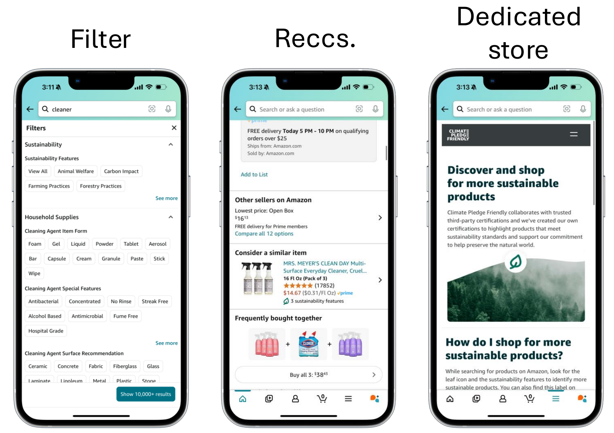
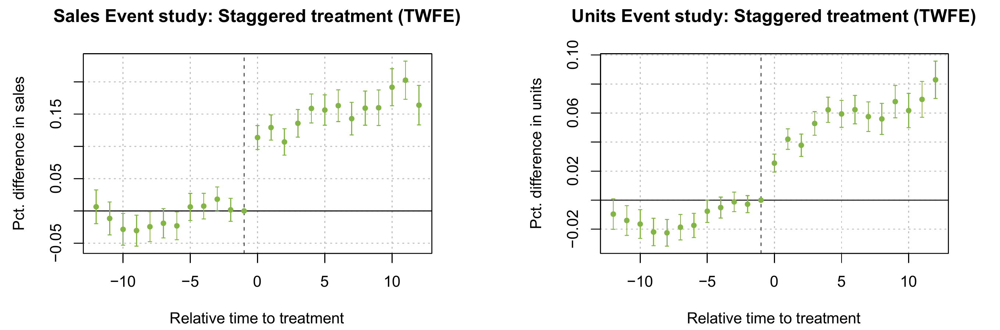

```{r setup}
#| include: false
library(data.table)
library(ggplot2)
library(scales)
library(knitr)

usc_red  <- "#990000"
usc_gold <- "#E69F00"
blue     <- "#0072B2"
grey     <- "#7a7a7a"
set.seed(566)

fmt_n <- function(x) format(x, big.mark = ",")
usd   <- function(x) paste0("$", format(round(x), big.mark = ","))
pct   <- function(x, d = 1) paste0(format(round(100 * x, d), nsmall = d), "%")

# --- 1. store promotions: demand drives both the promotion and sales ---
n_store <- 400
true_tau <- 10
st <- data.table(demand = rnorm(n_store))
st[, promo := rbinom(n_store, 1, plogis(-0.3 + 1.5 * demand))]
st[, sales := 100 + 20 * demand + true_tau * promo + rnorm(n_store, 0, 8)]
naive_st <- st[promo == 1, mean(sales)] - st[promo == 0, mean(sales)]
ctrl_st  <- coef(lm(sales ~ promo + demand, st))["promo"]
demand_gap <- st[promo == 1, mean(demand)] - st[promo == 0, mean(demand)]
share_promo <- st[, mean(promo)]
bars <- data.table(
  what = factor(c("True effect\n(we built the data)", "Naive comparison\npromo vs. no promo",
                  "Regression with\ndemand as a control"),
                levels = c("True effect\n(we built the data)", "Naive comparison\npromo vs. no promo",
                           "Regression with\ndemand as a control")),
  value = c(true_tau, naive_st, ctrl_st))
p_bars <- ggplot(bars, aes(x = what, y = value, fill = what)) +
  geom_col(width = 0.6) +
  geom_text(aes(label = round(value, 1)), vjust = -0.4, size = 5.5) +
  scale_fill_manual(values = c(grey, usc_red, blue), guide = "none") +
  scale_y_continuous(expand = expansion(mult = c(0, 0.15))) +
  labs(title = "What a promotion adds to weekly sales, three answers", x = NULL, y = "Estimated effect on sales") +
  theme_minimal(base_size = 14)

# --- 2. matching toy example ---
mt <- data.table(
  Customer = c("T1", "T2", "T3", "T4", "C1", "C2", "C3", "C4", "C5", "C6"),
  Group = c(rep("coupon", 4), rep("no coupon", 6)),
  `Propensity score` = c(0.80, 0.62, 0.45, 0.30, 0.81, 0.60, 0.47, 0.28, 0.10, 0.05),
  Sales = c(70, 58, 50, 44, 66, 55, 46, 43, 30, 25))
pairs <- data.table(
  Treated = c("T1", "T2", "T3", "T4"),
  `Treated score` = c(0.80, 0.62, 0.45, 0.30),
  `Matched control` = c("C1", "C2", "C3", "C4"),
  `Control score` = c(0.81, 0.60, 0.47, 0.28),
  `Treated sales` = c(70, 58, 50, 44),
  `Control sales` = c(66, 55, 46, 43))
pairs[, Difference := `Treated sales` - `Control sales`]
att_toy   <- mean(pairs$Difference)
naive_toy <- mt[Group == "coupon", mean(Sales)] - mt[Group == "no coupon", mean(Sales)]

# --- 3. DiD: a short-term-rental ban in one city ---
did <- data.table(
  City = c("City A (bans Airbnb)", "City B (no ban)"),
  `Avg. price before` = c("$500k", "$400k"),
  `Avg. price after`  = c("$520k", "$430k"),
  `After minus before` = c("+$20k", "+$30k"))
did_est <- 20 - 30
did_long <- data.table(
  city = rep(c("City A (bans Airbnb)", "City B (no ban)", "City A without the ban (counterfactual)"), each = 2),
  period = rep(c("Before", "After"), 3),
  price = c(500, 520, 400, 430, 500, 530))
did_long[, period := factor(period, levels = c("Before", "After"))]
did_long[, city := factor(city, levels = c("City A (bans Airbnb)", "City A without the ban (counterfactual)", "City B (no ban)"))]
cf_name <- "City A without the ban (counterfactual)"
p_did <- function(show_cf = FALSE) {
  d <- copy(if (show_cf) did_long else did_long[city != cf_name])
  d[, city := droplevels(city)]
  d[, vj := if (show_cf) fifelse(city == cf_name, -0.7, 1.6) else 0.5]
  cols <- c("City A (bans Airbnb)" = usc_red, usc_red, "City B (no ban)" = blue)
  names(cols)[2] <- cf_name
  lts <- c("City A (bans Airbnb)" = "solid", "dashed", "City B (no ban)" = "solid")
  names(lts)[2] <- cf_name
  g <- ggplot(d, aes(x = period, y = price, group = city, color = city, linetype = city)) +
    geom_line(linewidth = 1.3) + geom_point(size = 4) +
    geom_text(data = d[period == "After"], aes(label = paste0("$", price, "k"), vjust = vj),
              hjust = -0.3, size = 5, show.legend = FALSE) +
    geom_text(data = d[period == "Before"], aes(label = paste0("$", price, "k")),
              hjust = 1.3, size = 5, show.legend = FALSE) +
    scale_color_manual(values = cols, name = NULL) +
    scale_linetype_manual(values = lts, name = NULL) +
    scale_x_discrete(expand = expansion(mult = 0.35)) +
    scale_y_continuous(limits = c(380, 560)) +
    labs(title = "Average house price, before and after the ban", x = NULL, y = "Thousands of dollars") +
    theme_minimal(base_size = 14) + theme(legend.position = "top")
  g
}

# --- 3b. parallel trends: the same two cities year by year, in two versions of the world ---
# Both versions hit the table's numbers in 2022 (before) and 2024 (after), so DiD = -10 in both.
# Version 1: A and B move in parallel before the ban. Version 2: A was already growing more slowly.
yrs    <- 2019:2024
b_path <- c(355, 370, 385, 400, 415, 430)   # City B: +15 a year throughout
a_par  <- c(455, 470, 485, 500, 510, 520)   # version 1: +15 a year before the ban, +10 after
a_div  <- c(470, 480, 490, 500, 510, 520)   # version 2: +10 a year throughout (no effect of the ban)
cf_yrs <- 2022:2024
cf_path <- a_par[yrs == 2022] + (b_path[yrs %in% cf_yrs] - b_path[yrs == 2022])   # A's 2022 level + B's trend
stopifnot(a_par[yrs == 2022] == 500, a_div[yrs == 2022] == 500, a_par[yrs == 2024] == 520, a_div[yrs == 2024] == 520,
          b_path[yrs == 2022] == 400, b_path[yrs == 2024] == 430, cf_path[3] == 530,
          all(diff(a_par - b_path)[1:3] == 0))
city_a <- "City A (bans Airbnb)"; city_b <- "City B (no ban)"
trends <- rbind(
  data.table(version = 1, city = city_a, year = yrs, price = a_par),
  data.table(version = 1, city = city_b, year = yrs, price = b_path),
  data.table(version = 2, city = city_a, year = yrs, price = a_div),
  data.table(version = 2, city = city_b, year = yrs, price = b_path))
trends_cf <- rbind(data.table(version = 1, city = cf_name, year = cf_yrs, price = cf_path),
                   data.table(version = 2, city = cf_name, year = cf_yrs, price = cf_path))
p_trends <- function(explain = FALSE) {
  d <- if (explain) rbind(trends, trends_cf) else copy(trends)
  d[, city := factor(city, levels = c(city_a, cf_name, city_b))]
  d[, city := droplevels(city)]
  strip <- if (explain) c(`1` = "Version 1: parallel before the ban", `2` = "Version 2: already diverging before the ban")
           else c(`1` = "Version 1", `2` = "Version 2")
  cols <- setNames(c(usc_red, usc_red, blue), c(city_a, cf_name, city_b))
  lts  <- setNames(c("solid", "dashed", "solid"), c(city_a, cf_name, city_b))
  # value labels: first year, last year before the ban, last year
  lab <- d[(year %in% c(2019, 2022, 2024) & city != cf_name) | (city == cf_name & year == 2024)]
  lab[, vj := fifelse(city == city_a & year == 2024, 1.9, fifelse(city == city_b, 1.9, -0.9))]
  g <- ggplot(d, aes(x = year, y = price, group = city, color = city, linetype = city)) +
    geom_vline(xintercept = 2022.5, linetype = "dotted", color = grey, linewidth = 0.8) +
    annotate("text", x = 2022.58, y = 345, label = "ban", hjust = 0, color = grey, size = 4.5) +
    geom_line(linewidth = 1.2) + geom_point(size = 3) +
    geom_text(data = lab, aes(label = paste0("$", price, "k"), vjust = vj), size = 4.2, show.legend = FALSE) +
    facet_wrap(~ version, labeller = as_labeller(strip)) +
    scale_color_manual(values = cols, name = NULL) +
    scale_linetype_manual(values = lts, name = NULL) +
    scale_x_continuous(breaks = yrs, expand = expansion(mult = 0.08)) +
    scale_y_continuous(limits = c(335, 560)) +
    labs(title = if (explain) NULL else "Average house price, year by year", x = NULL, y = "Thousands of dollars") +
    theme_minimal(base_size = 14) +
    theme(legend.position = "top", panel.grid.minor = element_blank(),
          strip.text = element_text(face = "bold", size = 13), panel.spacing = unit(1.5, "lines"))
  if (explain) {
    note <- data.table(version = c(1, 2), year = 2020.5, price = c(428, 430),
                       label = c("gap: $100k every year", "gap: $115k, $110k, $105k, $100k"))
    g <- g + geom_text(data = note, aes(x = year, y = price, label = label), inherit.aes = FALSE,
                       color = grey, size = 4.2)
  }
  g
}

# --- 4. CPF results, retyped from the paper (log points) ---
to_pct <- function(b) pct(exp(b) - 1)
main_tab <- data.table(
  ` ` = c("After joining CPF", "", "Controls", "Observations"),
  `log Sales` = c("0.146***", "(0.009)", "No", "1,365,441"),
  `log Units` = c("0.059***", "(0.004)", "No", "1,365,441"),
  `log Sales ` = c("0.118***", "(0.008)", "Yes", "1,242,984"),
  `log Units ` = c("0.043***", "(0.003)", "Yes", "1,242,984"))
cross_tab <- data.table(
  ` ` = c("After × Treated", "", "Controls", "Observations"),
  `log Sales` = c("0.170***", "(0.023)", "No", "167,040"),
  `log Units` = c("0.119***", "(0.012)", "No", "167,040"),
  `log Sales ` = c("0.086***", "(0.016)", "Yes", "166,869"),
  `log Units ` = c("0.077***", "(0.008)", "Yes", "166,869"))
```

# Before We Start {.divider}

## Housekeeping

- Next Tuesday, Nov. 17: in-class **causality exercise**, the methods from this week on simulated coupon data. Bring your laptop; R users, install the `MatchIt` package before class
- **Homework 4** due **Nov. 24** on Brightspace
- Thursday, Nov. 19: class time to **work on your group project**
- Final presentations: **Dec. 1 and Dec. 3**

## Tuesday in one slide {.smaller-90}

- The effect of an action is **what happened minus what would have happened without it**. The second half, the **counterfactual**, is never observed
- **Randomization** solves it: a coin flip creates a control group that is the same kind of people as the treated group, so its average stands in for the missing world
- In advertising, **attribution** allocates credit and **incrementality** measures cause; only the second needs an experiment, and the two can disagree by a lot

::: {.box}
Today: what to do when **nobody flipped a coin**. The treatment happened, the data exist, and you still need the causal effect.
:::

# When You Cannot Randomize {.divider}

## Experiments are not always an option {.smaller-90}

- You cannot randomize a **city-wide policy**, a **law**, or a **platform-wide launch**: everyone gets it at once
- You cannot randomize **prices across customers** without fairness and legal trouble
- Sellers decide for themselves whether to **join a program**; customers decide whether to **redeem a coupon**. Nobody assigned them
- The decision was made **last year**, and the question arrives now. The data exist; the experiment does not

::: {.box}
**Observational data**: the treatment happened, but not because of a coin flip. Somebody, or something, chose who got it.
:::

## Experiments vs. observational data {.smaller-90}

| | Experiment (RCT) | Observational data |
|-------|-------------|---------------|
| Who assigns the treatment | you, at random | the market, the firm, the customers themselves |
| Causal inference | clean: compare the group averages | needs **assumptions** about why some units were treated |
| Cost | expensive, sometimes impossible | cheap, abundant, covers settings you could never experiment on |

::: {.box}
The whole game with observational data is to **rebuild the control group** that randomization would have given you, and to be honest about the assumptions that takes.
:::

## The threat: confounding {.smaller-90}

A **confounder** is a variable that does two things at once:

1. it affects **who gets the treatment**
2. it affects **the outcome**

Example: stores that run **promotions** sell more than stores that do not.

::: {.smaller-90 .muted}
Does the promotion cause the extra sales? What else could produce this pattern?
:::

## The threat: confounding, explained {.smaller-90}

- Maybe the promotion works. Or maybe store managers run promotions **when demand is already high** (a holiday, a local event, a good neighborhood)
- Then **demand** drives both: demand → promotion, and demand → sales. The promotion gets credit for sales that demand produced

::: {.box}
A confounder makes the treated and untreated groups **different kinds of units** before the treatment does anything. Comparing their averages mixes the treatment with the difference.
:::

## The selection problem {.smaller-90}

The customers, products, or stores that receive your marketing action are **not a random sample**:

- People who **see an ad** are more active shoppers (the platform targets them)
- Customers who **redeem a coupon** are more price sensitive
- Sellers who **adopt a new feature** are more sophisticated
- Products that **join a program** have owners who care about marketing

::: {.box}
Ignore selection and you get a **biased** estimate: usually too big, because the treatment went to the units that were going to do well anyway.
:::

## Three ways to rebuild the control group {.smaller-90}

| | Approach | In one line | What it needs |
|---|------|----------|---------|
| **1** | **Regression with controls** | compare treated and untreated **holding the confounders fixed** | you measured **every** confounder |
| **2** | **Matching** | pair each treated unit with an untreated **look-alike** | same as 1, plus look-alikes exist |
| **3** | **Difference-in-differences** | compare **changes over time** in treated vs. untreated | the two groups would have **moved in parallel** without the treatment |

- Approaches 1 and 2 use the **same assumption** and differ in mechanics. Approach 3 uses a different one, and needs data **before and after**
- Tuesday's exercise: approaches 1 and 2, by you. Today's case: approach 3, on real Amazon data

# Approach 1: Regression with Controls {.divider}

## Regression with controls: the idea {.smaller-90}

Compare treated and untreated units that are **similar on the confounders**, by putting the confounders in the regression:

$$\text{Sales}_i = \alpha + \tau\, \text{Promo}_i + \beta\, \text{Demand}_i + \varepsilon_i$$

- $\tau$ is the difference in sales between promo and no-promo stores **with the same demand**: the regression from week 4, used for a new purpose
- **Key assumption**: you measured **every** confounder and put it in. Then, among stores with the same demand, who runs a promotion is as good as random
- **Risk**: one confounder you did not measure, and $\tau$ is biased again. The simplest method, and the weakest

## Does the promotion work? Three answers {.smaller-90}

```{r bars}
#| fig-width: 8
#| fig-height: 4.2
p_bars
```

::: {.smaller-80 .muted}
`r fmt_n(n_store)` simulated stores, `r pct(share_promo, 0)` run a promotion. We built the data, so the true effect is **`r true_tau`**. What do you see?
:::

## Does the promotion work? Three answers, explained {.smaller-80}

```{r bars-2}
#| fig-width: 8
#| fig-height: 3
p_bars
```

- **Naive comparison**: promo stores sell `r round(naive_st, 1)` more. Far too big: in these data the promo stores' demand index is `r round(demand_gap, 2)` higher, so most of the gap is demand, not the promotion
- **Regression with demand as a control**: `r round(ctrl_st, 1)`, right on the truth. Demand was the only confounder, and we had it in the data
- The difference between `r round(naive_st, 1)` and `r round(ctrl_st, 1)` is the **bias** of the naive comparison. The naive number would have a manager tripling the promotion budget

## When you do not have the confounder {.smaller-90}

A retailer sends coupons to customers its model **predicts will be big spenders**. You have past purchases, demographics, and category preferences, so you run:

$$\text{Sales}_i = \alpha + \tau\, \text{Coupon}_i + \beta\, X_i + \varepsilon_i$$

- The problem: the coupon went to customers because of their **predicted future demand**. Your controls capture part of that, not all of it
- The part they miss is in $\varepsilon_i$, correlated with the coupon. $\tau$ is biased, and **no amount of data on the same variables** fixes it
- There is no test that tells you whether you have all the confounders. You argue it, and a skeptic argues back

# Approach 2: Matching {.divider}

## Matching: the idea {.smaller-90}

Instead of adjusting with a formula, **build the control group by hand**: for every treated unit, find an untreated unit that looked the same **before** treatment.

1. **Estimate the propensity score**: the probability of being treated, given the observables (a logit of treatment on the confounders, the logit from week 4)
2. **Match**: pair each treated unit with the untreated unit whose score is closest (nearest neighbor)
3. **Compare** the outcomes within the pairs

- Good when: you have **many** observables that explain who got treated, and enough untreated units to find look-alikes
- Same assumption as regression: **selection on observables**. Matching cannot fix a confounder you did not measure

## Matching by hand: ten customers {.smaller-80}

Four customers got the coupon, six did not. The propensity score is each customer's probability of getting the coupon, from their observables.

```{r mt-table}
kable(mt, align = "llcc")
```

::: {.smaller-90 .muted}
Which no-coupon customer would you pair with each coupon customer? And which no-coupon customers have no look-alike?
:::

## Matching by hand, explained {.smaller-80}

```{r pairs-table}
kable(pairs, align = "lclccccc")
```

- Each treated customer gets the control with the **nearest score**. Within the pairs, the coupon adds `r paste(pairs$Difference, collapse = ", ")`: average **`r format(round(att_toy, 1), nsmall = 1)`**
- C5 and C6 have scores far from any treated customer: **no look-alike**, so they are dropped. That is matching's safeguard against comparing unlike units
- The naive comparison, all four treated vs. all six controls, says `r round(naive_toy, 1)`: the two unmatched controls are low spenders and drag the control average down
- The matched estimate is the **ATT**: the effect **on the treated**, the customers who actually got the coupon

## Matching in practice {.smaller-90}

- **Caliper**: the maximum score distance you accept for a pair. Tight caliper, better matches, fewer of them. Loose caliper, more pairs, worse matches. You will try both on Tuesday
- **Check balance after matching**: the matched treated and control groups should have the same average observables, like the balance tables from Tuesday. If they do not, the matching failed
- **Common support**: if the treated units have no look-alikes at all (every treated score is above every control score), matching cannot help, and neither can regression
- In R: `matchit()` from the `MatchIt` package does steps 1 and 2; a regression on the matched data does step 3

# Approach 3: Difference-in-Differences {.divider}

## A policy question {.smaller-80}

City A **bans** short-term rentals (Airbnb); City B does not. We observe average house prices in both cities, **before and after** the ban.

```{r did-table}
kable(did, align = "lccc")
```

::: {.smaller-90 .muted}
What did the ban do to house prices in City A?
:::

## A policy question, explained {.smaller-80}

```{r did-table-2}
kable(did, align = "lccc")
```

- **+$20k** (before vs. after in A) is wrong: prices rose **everywhere**, by $30k in City B, which had no ban. Time is a confounder
- **+$120k** (A vs. B after) is wrong: A was already $100k more expensive **before** the ban. The cities are different kinds of places
- **Difference-in-differences** removes both: the change in A minus the change in B, $20k − $30k = **−$10k**. The ban lowered prices by $10k relative to what they would have been

## The same thing, as a picture

```{r did-plot}
#| fig-width: 8
#| fig-height: 4.3
p_did(FALSE)
```

::: {.smaller-80 .muted}
What do you see? Where would City A's line have gone **without** the ban?
:::

## The same thing, as a picture, explained {.smaller-80}

```{r did-plot-2}
#| fig-width: 8
#| fig-height: 3.3
p_did(TRUE)
```

- The dashed line is the **counterfactual**: City A's starting point plus City B's trend. It is the missing world from Tuesday, rebuilt from City B
- The effect is the gap between where A ended up and where the dashed line says it would have been: $520k − $530k = **−$10k**
- City B's job is to supply the **trend**. City A supplies its own starting level

## The key assumption: parallel trends {.smaller-90}

The dashed line borrowed City B's trend. That only works if, without the ban, the two cities would have moved **the same way**: the **parallel trends** assumption. Here are the same two cities **year by year**, in two versions of the world. In both, 2022 (before) and 2024 (after) are the numbers from our table, so DiD says −$10k in both.

```{r trends-plot}
#| fig-width: 10
#| fig-height: 3.7
p_trends(FALSE)
```

::: {.smaller-80 .muted}
What do you see before the ban? In which version do you believe the −$10k?
:::

## Parallel trends, explained {.smaller-80}

```{r trends-plot-2}
#| fig-width: 10
#| fig-height: 3.3
#| out-width: "84%"
p_trends(TRUE)
```

- **Version 1**: the gap is $100k every year before the ban and changes only after it. City A would plausibly have kept following City B (the dashed line). The −$10k is credible
- **Version 2**: City A was already growing more slowly, $10k a year against City B's $15k. After the ban it kept its own pace: the ban did nothing, and DiD still says −$10k

::: {.box}
Parallel trends is about a world that did not happen, so it cannot be tested directly. What you can check is the **pre-period**. That is why DiD studies plot the groups period by period, as you will see in the Amazon case.
:::

```{=html}
<style>
.reveal section img[src*="trends-plot-2"], .reveal section img[data-src*="trends-plot-2"] { display: block; margin-left: auto; margin-right: auto; }
</style>
```

## When DiD fits {.smaller-90}

Three things need to be true:

1. The treatment happens at a **clear point in time**: a policy change, a product launch, a feature rollout
2. **Some units are affected and others are not**, and the others are a sensible comparison
3. You observe the outcome for **both groups, before and after**

| Question | Treated | Control |
|-------|------|------|
| Does a short-term-rental ban affect house prices? | cities that ban Airbnb | cities that do not |
| Does a sustainability badge raise sales? | products that get the badge | products that do not |
| Does free shipping raise sales? | regions where it was introduced | other regions |
| Does replying to reviews improve future ratings? | restaurants that start replying | restaurants that do not |

## DiD as a regression {.smaller-90}

With two groups and two periods, the DiD number is one coefficient:

$$Y_{it} = \alpha + \beta\, \text{Treated}_i + \gamma\, \text{After}_t + \tau\, (\text{Treated}_i \times \text{After}_t) + \varepsilon_{it}$$

- $\beta$: the pre-existing gap between the groups (A is $100k more expensive)
- $\gamma$: the common trend (prices rose $30k everywhere)
- $\tau$: the **difference-in-differences**, the effect (−$10k)

# Case: Amazon's Climate Pledge Friendly {.divider}

## What Climate Pledge Friendly (CPF) is {.smaller-90}

- An Amazon program that helps customers **discover products with sustainability features**
- A product qualifies through one of **60+ trusted certifications** (Blue Angel, Carbon Trust, Cradle to Cradle, ...) or Amazon's own
- 14 countries, **2.2 million products**, 271,000 selling partners
- Customers can find CPF products through a **badge** on the product page, a **search filter**, **recommendations**, or a **dedicated storefront**

{fig-align="center" width="58%"}

## The badge, from search to product page

{fig-align="center" width="80%"}

## Three more ways to find CPF products

{fig-align="center" width="78%"}

## The value-action gap {.smaller-90}

- In surveys, consumers say they **prioritize sustainability**. Whether that shows up in **actual purchases** is an open debate: the gap between stated and revealed preferences
- Whether a program like CPF turns the stated preference into sales depends on
  - **comprehension and trust**: do customers understand the badge and believe it?
  - **beliefs**: cultural and political attitudes toward sustainability
  - **willingness to pay**: is the customer ready to pay more, or anything at all, for it?

::: {.box}
Amazon's question: **does the CPF badge causally change what customers buy?**
:::

## Why not just compare CPF and non-CPF products? {.smaller-90}

CPF products sell more than non-CPF products. Is that the badge?

::: {.smaller-90 .muted}
Using today's vocabulary: what is the confounding story, and what is the selection story?
:::

## Why not just compare, explained {.smaller-90}

- **Confounding**: CPF and non-CPF products differ in ways we cannot see (brand strength, quality, the kind of seller behind them), and those differences move sales on their own
- **Selection**: a product that goes through certification has a seller who **does other things too** (marketing, pricing) around the same time. The sales lift may be theirs, not the badge's

**The approach**

- A **difference-in-differences** that exploits products joining CPF **at different times** (staggered adoption)
- A **short window**, 12 weeks before and after joining, so that fewer other things can change in the meantime
- **Controls** for the things that do change: price, discounts, ad spend, ratings and reviews

## The data {.smaller-90}

- A random sample of products from two populations: those that **eventually join CPF**, and those that **never do**
- About **45,000 products** (36,000 eventually CPF) across three categories: consumables, hardlines, softlines
- **Weekly** data, July 2021 to January 2024: about **4 million** product-week observations
- Two outcomes: weekly **sales** and **units shipped**
- Controls: price, discount, ad spend, ratings, and reviews

## Results: the gap between CPF and control products, week by week

{fig-align="center" width="92%"}

::: {.smaller-80 .muted}
Each dot: the difference between products that joined CPF and the controls, by week relative to joining (week 0). What do you see before and after week 0?
:::

## Results, explained {.smaller-80}

{fig-align="center" width="70%"}

- **Before week 0** the dots sit near zero: CPF products and controls were moving in parallel. That is the pre-trends check, and it passes
- **At week 0** sales jump by about 0.12 to 0.15 log points (roughly **13% to 16%**) and stay there; units jump by about 0.03 to 0.06 (roughly **3% to 6%**) and keep growing
- The jump is immediate, which fits a **badge** that changes what customers see the day it appears

## Main results: the numbers {.smaller-80}

Staggered DiD, product and week fixed effects, standard errors clustered by product. Coefficients are in log points.

```{r main-tab}
kable(main_tab, align = "lcccc")
```

- Without controls: `r to_pct(0.146)` more sales, `r to_pct(0.059)` more units (a log coefficient $b$ is about $e^b - 1$ in percent)
- With controls for price, promotions, ad spend, ratings, and reviews: **`r to_pct(0.118)`** more sales, **`r to_pct(0.043)`** more units
- The controls cut the estimate by about **20%** for sales and **27%** for units: part of the raw jump was sellers doing other things when they joined. The rest is the badge

## What the case concludes {.smaller-90}

- The CPF badge **does** change purchase behavior: with controls, **`r to_pct(0.118)` more sales** and **`r to_pct(0.043)` more units** in the 12 weeks after joining
- Making sustainable products **easier to find** lets customers act on the preferences they state in surveys
- Brands that join sustainability programs benefit

::: {.box}
The causal claim rests on **parallel pre-trends** (checked in the plot) and **controls** for what sellers change when they join.
:::

# Wrapping Up {.divider}

## Takeaways {.smaller-90}

- Observational data **can** support causal claims, but every method rests on an assumption about **why some units were treated**
- The enemy is **selection**, or **confounding**: the treated units were different before the treatment did anything
- **Regression with controls** and **matching** assume you measured every confounder. **Difference-in-differences** assumes parallel trends instead, and needs before-and-after data
- The methods differ in **how they rebuild the counterfactual**: adjust with a formula, find look-alikes, or borrow a trend from a control group
- Always **show evidence** for the assumption: balance tables for matching, pre-trend plots for DiD. A causal estimate without it is a correlation with a confident name

## Tuesday: the coupon, in three worlds {.smaller-90}

An in-class exercise, no code given, with your AI assistant:

- One retailer, one coupon, **three versions of the world**: assigned at random, targeted on things you can see, targeted on things you cannot
- You run the naive comparison, regression with controls, and matching in each world, and see **which method survives where**
- The data are simulated, so the true effect is known: you grade your own estimates
